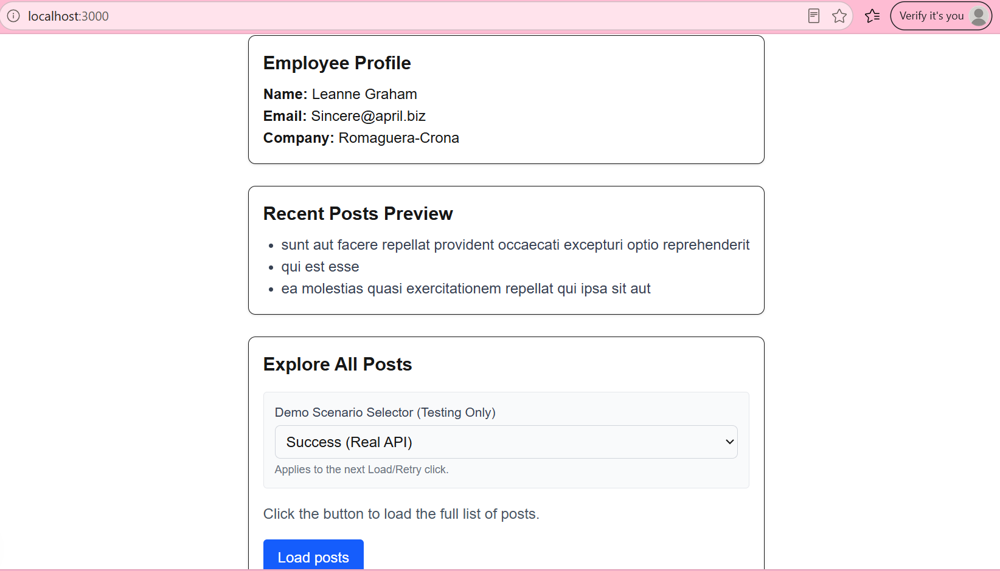
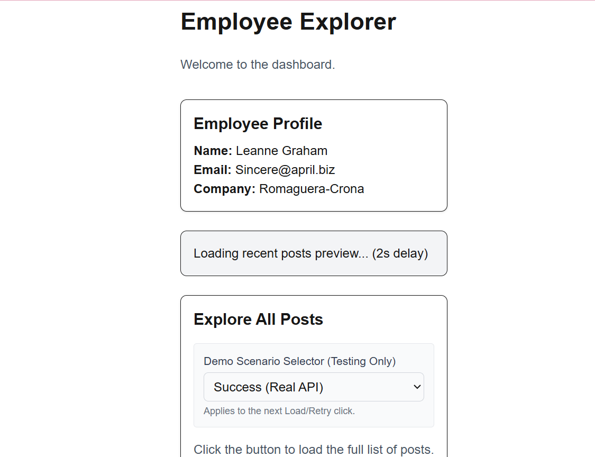
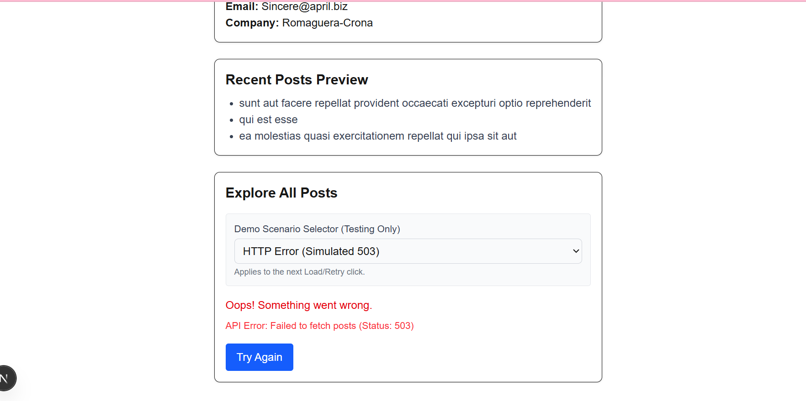
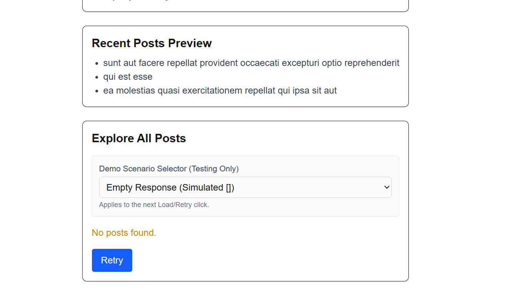

# Testing Evidence

## Test Matrix

| Check | Expected Result | Actual Result | Pass/Fail |
| :--- | :--- | :--- | :--- |
| **Server profile** | Name, email, and company from employee 1 appear instantly. | [e.g., Leanne Graham, Sincere@april.biz, Romaguera-Crona appeared] | Pass |
| **Server preview** | Fallback appears during the 2s delay; page shell stays visible. | [e.g., "Loading recent posts..." showed for 2s while title and profile stayed visible] | Pass |
| **Client idle** | No client posts request starts before the first click. | [e.g., Network tab showed 0 requests to /posts before clicking] | Pass |
| **Client slow** | Loading feedback visible; repeat clicks cannot start duplicate requests. | [e.g., "Loading posts..." appeared for 2s and button was disabled] | Pass |
| **Client success** | Returned titles and bodies appear. | [e.g., 10 posts with titles and bodies appeared] | Pass |
| **HTTP failure** | Shared response check creates and handles custom error. | [e.g., "API Error: Failed to fetch posts (Status: 503)" appeared] | Pass |
| **Empty response** | Empty-state message appears without being treated as an error. | [e.g., "No posts found" appeared in yellow text] | Pass |
| **Recovery** | Switching to Success and retrying displays posts and clears error. | [e.g., Error cleared, posts appeared] | Pass |
| **Section independence** | A failed client request does not remove the profile or preview. | [e.g., Profile and Preview stayed visible during the client 503 error] | Pass |
| **Usability** | Controls have labels, keyboard focus is visible, readable around 360px. | [e.g., Dropdown has a label, focus ring is visible, layout stacks on mobile] | Pass |

## Screenshots & Timing Description

*(Maya requires descriptions because a screenshot cannot prove timing by itself.)*

**1. Normal State**

*   **Steps used:** Loaded the page and clicked "Load posts" with the "Success" scenario selected.

**2. Server Preview Loading (2-second delay)**

*   **Steps used:** Hard refreshed the page (`Ctrl + Shift + R`). 
*   **Observation:** The title and Employee Profile appeared instantly, while the preview box showed the fallback for exactly 2 seconds due to the intentional `connection()` delay.

**3. Client Error (Simulated 503)**

*   **Steps used:** Selected "HTTP Error" in the dropdown and clicked "Load posts".
*   **Observation:** The error box appeared. The Server Profile and Preview remained visible and unaffected.

**4. Empty State (Simulated [])**

*   **Steps used:** Selected "Empty Response" in the dropdown and clicked "Load posts".
*   **Observation:** The "No posts found" message appeared, proving it wasn't treated as an error.

## Command Outputs

**`npm run lint`**
*   **Outcome:** Initially failed due to React 19's strict rule against constructing JSX inside `try/catch` blocks, and an unescaped apostrophe. I refactored the components to move the JSX `return` statements outside the `try/catch` and fixed the text. The second run passed with 0 errors.

**`npm run build`**
*   **Outcome:** Passed successfully. The `/` route built as a Dynamic route (`ƒ`) because of the `connection()` function, ensuring the 2-second delay runs on every request.